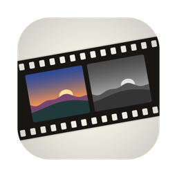
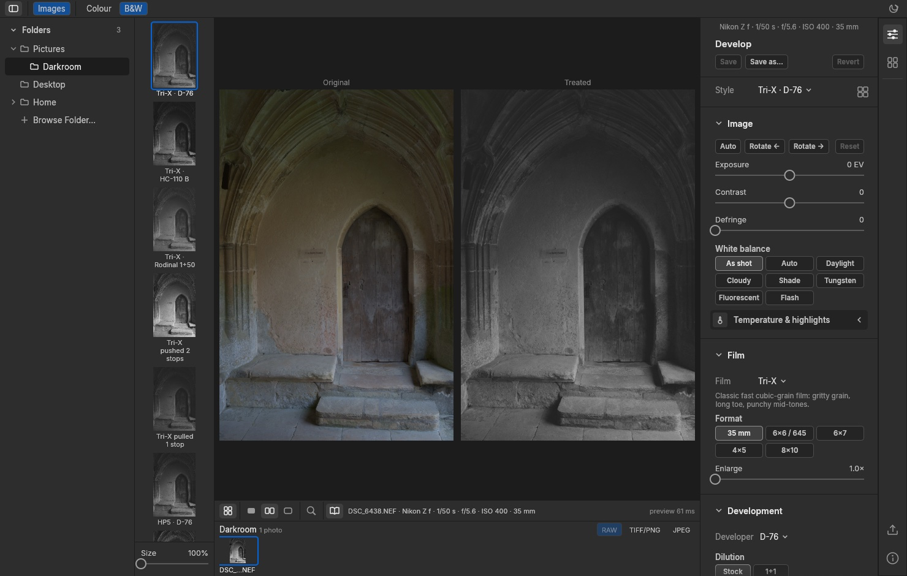

<p align="center">
  
</p>

# Film Darkroom

A film emulation engine in Rust for colour and black and white, with a desktop app and a
command-line tool. It turns digital raw files (NEF, DNG, ARW) into film prints by modelling
the film rather than grading the image:

- **Black and white:** film, developer and processing as separate components that
  interact through a simulated negative, printed on a measured paper.
- **Colour:** three dye layers with their own spectral sensitivity and curves, interlayer
  effects, halation, per-layer grain, a lab that times each print to grey, and paper,
  cinema print film or a neutral scan.

One switch in the app, **Colour | B&W**, chooses the process. Film Darkroom combines and
replaces BW Darkroom (black and white, versions 0.1–0.11) and Colour Darkroom (colour,
unreleased); it reads their styles and per-photo adjustments, and never changes them.

| Colour | Black and white |
|---|---|
|  |  |

> **Status:** early prototype.
>
> - **Black and white:** Tri-X, T-Max 100 and T-Max 400 in D-76 (plus Tri-X and T-Max 400
>   in HC-110 B and D-76 1+1) and both printing papers are fitted to Kodak's published
>   curves; the Ilford films are calibrated from Ilford's published curves at a lower
>   level; the rest are **illustrative**. See
>   [design 0001](docs/design/0001-negative-simulation-model.md) and
>   [design 0002](docs/design/0002-datasheet-calibration-and-paper.md).
> - **Colour:** every film and print stock is **illustrative**: its parameters were chosen
>   to give the character photographers describe for the named product, not fitted to its
>   datasheet. See [design 0003](docs/design/0003-colour-film-model.md).
>
> Product names describe the intended look only.

## Get it

**[Download the latest release](https://github.com/catskinroyale/film-darkroom/releases/latest)**
for macOS or Windows from its Assets. No compiling needed.

- **Mac** (Apple Silicon, M1 or later): `Film-Darkroom-<version>-arm64.dmg`. Open it and
  drag **Film Darkroom** to **Applications**. The app isn't notarised by Apple, so open it
  the first time with **right-click → Open**, or allow it in System Settings → Privacy &
  Security.
- **Windows** (10 or 11, 64-bit): `Film-Darkroom-<version>-x64.zip`. Extract it and run
  **Film Darkroom.exe** from the folder. The exe isn't code-signed, so SmartScreen may
  warn the first time: **More info → Run anyway**.

BW Darkroom's releases (black and white only, up to 0.11.1) remain at
[catskinroyale/bnw-darkroom](https://github.com/catskinroyale/bnw-darkroom/releases). To
build Film Darkroom yourself, see [Build and run](#build-and-run).

To use the app, see the [user guide](docs/USER_GUIDE.md). For a longer tour of the
black-and-white process with screenshots, read the [article](docs/article/article.md)
(written for BW Darkroom; the black-and-white mode works the same way).

## Films and prints

| Black-and-white films | Developers | Papers |
|---|---|---|
| Tri-X, T-Max 100 and 400, HP5 Plus, FP4 Plus, Delta 100, 400 and 3200, Double-X, Kentmere 100, 200 and 400 | D-76 (stock, 1+1), D-96, HC-110 (B, E, H, G), Rodinal (1+25, 1+50, 1+100), FX-55 | Polymax II RC (glossy), Polycontrast IV RC (matte) |

| Colour negatives | Slides | Colour prints |
|---|---|---|
| Portra 160, 400, 800 · Ektar 100 · Gold 200 · UltraMax 400 · Pro 400H · Superia 400 · Vision3 250D, 500T · CineStill 800T | Ektachrome E100 · Velvia 50 · Provia 100F | Neutral scan · Endura paper · Crystal Archive paper · 2383 and 3513 print film |

## Layout

| Path | Contents |
|---|---|
| `crates/fd-core` | Planes, scenes, film geometry, monotone curves, deterministic noise, blur, film compression |
| `crates/fd-io` | Image loading and export (TIFF, JPEG, PNG; greyscale and colour, with EXIF) |
| `crates/fd-raw` | Camera raw input (NEF, DNG, ARW) via LightCraft's `lightcraft-raw`; exposure, white balance, highlights, defringe |
| `crates/mono-film`, `crates/mono-developer` | Black-and-white film stocks; developer behaviour and processing conditions |
| `crates/mono-negative` | Negative simulation: exposure, development, adjacency, grain; development-time table and calibrations |
| `crates/mono-darkroom` | Printing on measured paper grade families |
| `crates/colour-film` | The colour model: stocks, exposure, light effects, curves, interlayer, grain, printing, dyes |
| `crates/fd-profiles` | Styles for both processes (`Style = Mono \| Colour`), render entry points, export recipe |
| `apps/fd-desktop` | `film-darkroom` desktop app (egui) |
| `apps/fd-cli` | `film` command-line tool |
| `data/development` | Development times: raw Massive Dev Chart extract and the curated table |
| `data/sensitometry` | Manufacturer curves read from datasheets, one folder per source |
| `data/calibrations`, `data/papers` | Fitted development calibrations and paper grade families |
| `tools/` | Datasheet curve reading and fitting (design 0002), release, packaging (macOS, Windows), licences, icon |
| `docs/` | User guide, designs 0001–0004, decision log, research |

## Build and run

Requires [Rust](https://rustup.rs) on macOS (Apple Silicon) or Windows (with the Visual
Studio C++ build tools); the toolchain pinned in
`rust-toolchain.toml` is installed automatically by rustup. Raw decoding comes from
LightCraft's repository on GitHub, so the first build needs a network connection.

```sh
cargo test --release                                     # all tests
cargo run --release -p fd-desktop -- ~/Pictures          # desktop app (optional folder or image)
cargo run --release -p fd-cli -- sheet photo.NEF --out sheet.jpg
cargo run --release -p fd-cli -- variations --input chart --out out/chart
```

### macOS app

```sh
tools/package-macos.sh   # → dist/Film Darkroom.app and dist/Film-Darkroom-<version>-arm64.dmg
```

The app is ad-hoc signed, not notarised: on another Mac, open it the first time with
right-click → Open. Set `SIGN_IDENTITY="Developer ID Application: …"` to sign it properly,
then notarise the DMG with `xcrun notarytool` and `xcrun stapler`.

### Windows app

```sh
tools/package-windows.sh   # in Git Bash → dist/Film-Darkroom-<version>-x64.zip
```

GitHub Actions (`.github/workflows/windows.yml`) builds and tests every push on Windows
and attaches the zip to each published release.

Nikon High Efficiency (HE/HE★) NEFs are not supported; use lossless compressed NEF.
Set `FILM_RAW_SAMPLE=/path/to/file.NEF` to include a real raw file in `cargo test`.

After editing `data/development/mdc-times.csv`, run `python3 -I tools/curate_times.py`.

## Licensing

| Part | Licence |
|---|---|
| `crates/fd-core` | MIT ([LICENSE-MIT](LICENSE-MIT)) |
| All other crates, `apps/fd-desktop` and `apps/fd-cli` | Apache-2.0 ([LICENSE-APACHE](LICENSE-APACHE)) |

Each crate's `Cargo.toml` states its licence. The About window lists every third-party
component compiled into the app with its licence (`tools/gen_licenses.py` regenerates the
list; the packaging script runs it). New crates default to Apache-2.0 through the
workspace setting.

Third-party code keeps its own licence: `lightcraft-raw` and its supporting crates are
MIT OR Apache-2.0; the interface adapts LightCraft's (MIT); Inter is SIL OFL 1.1. The
development-time data in `data/development/` is compiled from the Massive Dev Chart
(Digital Truth) and is not covered by this project's licences. The curves in
`data/sensitometry/` are Kodak's and Ilford's, read from their datasheets (each folder's
README names the document); they are not covered by this project's licences either.

## Data sources

Development times come from the Massive Dev Chart (Digital Truth), read from Internet
Archive snapshots; each raw row links its source. Kodak and Ilford data-sheet findings are
in `docs/research/`.
