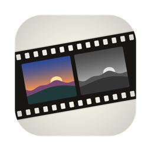
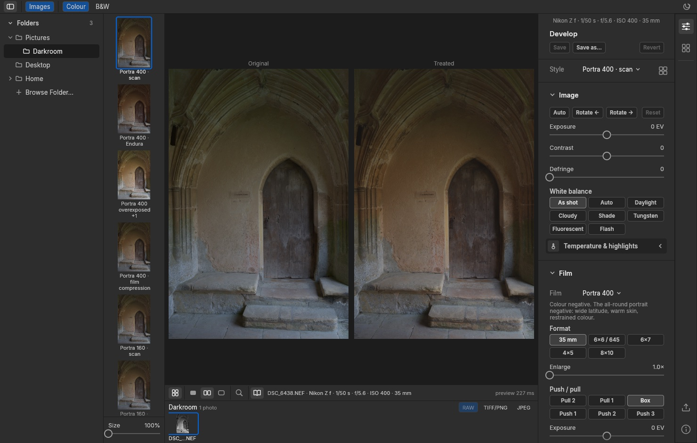
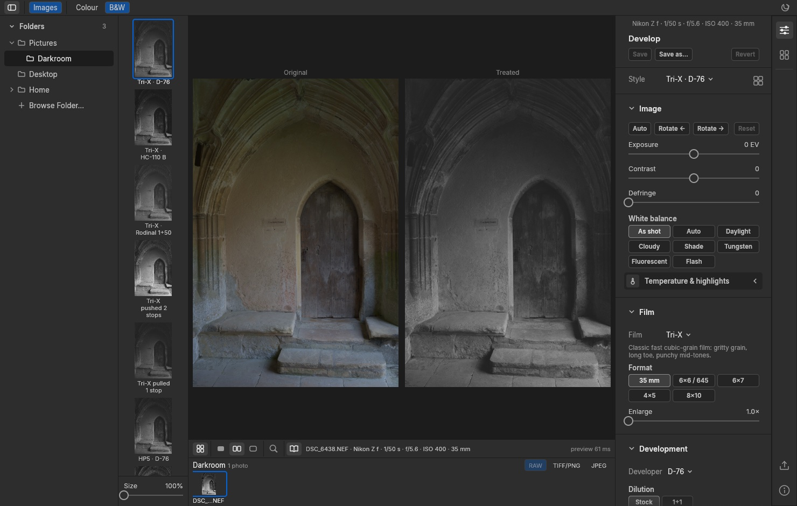

# Film Darkroom user guide

Film Darkroom turns your photographs into film prints by simulating the film and the
darkroom, in colour or in black and white. It doesn't apply a filter. It models the stages
in order:

1. **Film:** how the emulsion records light: its colour sensitivity, tone curve and grain.
2. **Processing:** for black and white, the developer, dilution, time, temperature and
   agitation; for colour, the film's processing, push and pull.
3. **Negative (or slide):** the result of exposing and processing the film.
4. **Print:** enlarging the negative onto paper of a chosen contrast grade (black and
   white), or printing it on colour paper or cinema print film, or scanning it (colour).

Every style in the app is a recipe of those components, so you can change one stage and
see its effect on the rest.

> **About accuracy.** Film behaviour is modelled from published data where there is some.
>
> - **Black and white.** The **Calibration** line under Development details says which
>   you're looking at. **Level 2 (sensitometric):** Tri-X, T-Max 100 and T-Max 400 in D-76,
>   fitted to Kodak's published curves; Tri-X and T-Max 400 in HC-110 B and D-76 1+1, from
>   Kodak's contrast charts; both papers. **Level 1 (approximation):** HP5 Plus, FP4 Plus
>   and the Delta films, from the one curve Ilford publishes per film. **Illustrative:**
>   everything else (Kentmere, Double-X, Rodinal and FX-55 with Kodak films).
> - **Colour.** Every film and print stock is **illustrative**: its parameters were chosen
>   to give the character photographers describe for the named film, judged by eye, not
>   measured from its datasheet.
>
> A style named "Kentmere 400 · Rodinal" or "Portra 400 · scan" describes the intended
> look, not a calibrated copy of the product.

## Contents

- [Installing](#installing) (and [update notices](#update-notices))
- [Colour or black and white](#colour-or-black-and-white)
- [The window](#the-window)
- [Opening photos](#opening-photos)
- [Preparing the image](#preparing-the-image)
- [Choosing a style](#choosing-a-style)
- [The Develop panel](#the-develop-panel)
- [Black and white: development, push and pull](#black-and-white-development-push-and-pull)
- [Colour: film, light and print](#colour-film-light-and-print)
- [Film compression](#film-compression)
- [Grain](#grain)
- [Checking detail at 100% and 200%](#checking-detail-at-100-and-200)
- [Black-and-white printing controls](#black-and-white-printing-controls)
- [Saving and managing styles](#saving-and-managing-styles)
- [Exporting](#exporting)
- [Keyboard shortcuts](#keyboard-shortcuts)
- [Where things are stored](#where-things-are-stored)
- [Coming from BW Darkroom or Colour Darkroom](#coming-from-bw-darkroom-or-colour-darkroom)
- [The command line](#the-command-line)
- [Troubleshooting](#troubleshooting)

## Installing

Film Darkroom runs on Apple Silicon Macs and on 64-bit Windows 10 and 11. Its icon is a
strip of film on a lightbox, the same sunset in a colour frame and a black-and-white
frame. Download it from the
[releases page](https://github.com/catskinroyale/film-darkroom/releases).

**Mac**

1. Download `Film-Darkroom-<version>-arm64.dmg`.
2. Open the DMG and drag **Film Darkroom** onto **Applications**.
3. The first time you open it, **right-click the app → Open**, then confirm. The app isn't
   notarised by Apple, so a normal double-click is blocked the first time. You can also
   allow it in System Settings → Privacy & Security → Open Anyway.

**Windows**

1. Download `Film-Darkroom-<version>-x64.zip`.
2. Right-click the zip → **Extract All…**, and put the **Film Darkroom** folder wherever
   you keep programs (for example your Documents or `C:\Program Files`).
3. Double-click **Film Darkroom.exe**. The app isn't code-signed, so the first time
   Windows SmartScreen may say it protected your PC: click **More info → Run anyway**.
   To start it from the Start menu, right-click the exe → **Pin to Start**.

To update, quit the app and replace it with the new version (the app in Applications, or
the Film Darkroom folder on Windows). Your styles and settings are kept.

To build it from the source code instead (needs [Rust](https://rustup.rs)):

```sh
git clone https://github.com/catskinroyale/film-darkroom.git
cd film-darkroom
cargo run --release -p fd-desktop -- ~/Pictures
```

### Update notices

Once a day, when it starts, Film Darkroom asks GitHub whether a newer version has been
released. If there is one, an **Update** button appears in the top bar. Click it to see
what's new, then:

- **Download…** opens the release page in your browser, with the DMG (Mac) and zip
  (Windows) to download.
- **Later** hides the dialog until next time.
- **Skip This Version** stops the notice for that version.

**Film Darkroom ▸ Check for Updates…** on the Mac, or the button in the About window
(**About** in the top bar on Windows), checks straight away. To turn off the daily check, untick **Check for updates automatically** in
the Software Update window.

The check sends nothing except the request itself, and nothing is downloaded or
installed without you.

## Colour or black and white

The **Colour | B&W** switch in the top bar (or **M**) chooses the process you're working
in.





The switch decides:

- which styles the **Style** picker, the **Styles** panel and the column of previews show;
- which sections the **Develop** panel has (black and white: Film, Development, Film
  compression, Grain, Print; colour: Film, Film compression, Light, Grain, Print);
- what the export is: a greyscale or a colour file.

Each process keeps its own style, including unsaved changes, while you look at the other,
and the app remembers the last style you used in each. The **Image** section, with your
per-photo adjustments (exposure, white balance, rotation and so on), is shared: those
settings belong to the photo, whichever process you print it with.

## The window

| Area | What it's for |
|---|---|
| **Top bar** | The sidebar icon (far left) shows or hides the folder tree, **Images** the strip under the photo, and **Colour / B&W** chooses the process. The theme icon (far right) steps through **Auto**, **Light** and **Dark**. |
| **Folders** (left) | A tree of folders: choose the one you're working in. |
| **Image** (centre) | The selected photo rendered with the current style, or compared with the original. |
| **Toolbar** (under the photo) | A grid icon that shows or hides the style column, then icons for the **Treated**, **Side by side** and **Original** views, **Detail 1:1** (magnifying glass), and a book that shows or hides the file name and capture details. |
| **Tool strip** (far right) | Icons that choose the panel beside it: **Develop** and **Styles** at the top, **Export** and **About** at the bottom. Click the active icon again to hide the panel. |
| **Develop** panel (right) | The style picker, the Image section and the process's sections. |
| **Styles** panel (right) | Every style of the current process, in groups. |
| **Styles** column (left, beside the folders) | The current photo rendered with every style of the current process, to compare them at a glance. The **Size** slider at its base makes the previews up to twice as large (double-click it to reset). Show or hide it with the grid icon at the left of the toolbar. |
| **Images** strip (very bottom) | The photos in the chosen folder: click one to open it. |

The Develop panel's sections open and close with a click on their title, and remember how
you left them. Advanced controls sit in expandable rows inside a section (for example
**Development details** or **Colour layers**); click a row to open it.

**Sliders:** drag the track (hold **Shift** for fine control), **double-click** the
name or the knob to reset it, or **click the value** to type one (Return applies, Esc
cancels).

Panels can be resized by dragging their edges. **F** hides every panel for a clean view
of the image and brings them back.

Hover over almost any control for a short explanation.

## Opening photos

Choosing a photo takes two steps: pick a folder in the **Folders** tree on the left, then
pick a photo from the **Images** strip under the photo.

- The tree starts from **Pictures**, **Desktop**, **Home** and any memory card or
  external drive. Click a folder to show its photos in the strip; click the chevron beside
  it to show or hide its subfolders. The tree opens down to the folder you're in.
- **Browse Folder…** at the end of the tree picks
  any folder, such as one on a network drive. Right-click a folder for **Show in Finder**
  (**Show in Explorer** on Windows).
- On Windows the drives (C:, D:, memory cards) are listed after Home.
- Apps and other macOS packages (`.app`, Photos and Lightroom libraries) aren't listed.
- In the strip, long file names are shortened in the middle, keeping the start and the
  frame number ("Reykjav…042.NEF"). Hover a photo to see its full name.

**Raw files first.** Film Darkroom is built for camera raw files: Nikon NEF, DNG
(including Leica), Sony ARW and Fujifilm RAF (X-Trans and Bayer sensors). They're always
listed. JPEG, TIFF and PNG files are hidden
unless you turn on **TIFF/PNG** or **JPEG** in the strip's header. The count tells you how
many files are hidden.

Use the arrow keys to step through the photos in the folder; the strip follows.

Nikon High Efficiency (HE/HE★) NEFs aren't supported; use lossless compressed NEF.

## Preparing the image

The **Image** section at the top of the Develop panel adjusts the photo *before* it
reaches the film, like choices made in the camera. These settings belong to the photo,
not to the style or the process. They're saved next to it and come back when you reopen
it.

- **Exposure** brightens or darkens the scene in stops. **Auto** picks a value from the
  image. Auto aims the average at mid-grey, so check it on night or high-key scenes.
- **Contrast** changes the scene's contrast around mid-grey, like a lighting ratio.
- **Defringe** removes the yellow, blue, purple or green edges lens chromatic aberration
  leaves along bright, high-contrast edges (railings, branches against the sky), which
  colour film would otherwise exaggerate. It only touches colour at strong edges.
- **White balance** (raw only) sets which light counts as neutral. Choose a preset, or set
  your own **Temperature** and **Tint** under **Temperature & highlights**.
  - In **colour**, the film is treated as balanced (or filtered) for that light. For
    tungsten film's blue look in daylight (Vision3 500T, CineStill 800T), set white
    balance to **Daylight**; under lamps, use **Tungsten** for neutral colour.
  - In **black and white**, film turns colours into greys, so white balance changes which
    tones come out lighter or darker, much like a coloured filter on the lens.
- **Highlights** (raw only, under **Temperature & highlights**): **Reconstruct** recovers
  detail where the sensor clipped; **Clip** renders clipped areas as plain white.
- **Rotate ← / Rotate →**, and **Reset** to return to the camera's settings.

**Comparing with the original.** The toolbar under the photo has three views:

- **Treated** (filled frame, the default): the photo as printed with the current style.
- **Side by side** (two frames): the original and the treated photo next to each other.
  Click it again to go back to Treated.
- **Original** (empty frame): the photo before the film, with your Image adjustments.

**C** steps through the three views; **O** switches between Original and Treated.

## Choosing a style

Choose a style from the **Style** row at the top of the Develop panel, or open the
**Styles** panel (its icon in the tool strip, or the grid button beside the Style row).
Click one to apply it. The column of previews shows the current photo in every style of
the process; click one to apply that style.

**Black and white** styles come in three groups: **Films & processes**, **Photographers**
and **My styles**. They cover:

- **Films:** Tri-X, T-Max 100 and 400, HP5, FP4, Delta 100, 400 and 3200, Double-X,
  Kentmere 100, 200 and 400.
- **Developers:** D-76 (stock, 1+1), D-96, HC-110 (dilutions B, E, H, G), Rodinal (1+25,
  1+50, 1+100), FX-55.
- **Processes and prints:** pushed and pulled processing, stand development, hard and soft
  paper grades.

The **Photographers** group offers looks inspired by Don McCullin, Ansel Adams, Bill
Brandt, Josef Koudelka and Edward Weston. Hover one to see the look and what is
documented about the photographer's working methods versus what is interpretation.
Clicking one uses its film, developer, processing and print recipe, and sets scene
contrast where the look calls for it.

**Colour** styles come in **Negative films**, **Slide films** and **My styles**:

- **Negatives:** Portra 160, 400 and 800, Ektar 100, Gold 200, UltraMax 400, Pro 400H,
  Superia 400, Vision3 250D and 500T, CineStill 800T.
- **Slides:** Ektachrome E100, Velvia 50, Provia 100F.
- **Prints:** a neutral scan, Endura and Crystal Archive paper, 2383 and 3513 print film.

## The Develop panel

Below the style picker, the Develop panel has the Image section and then the process's
sections:

| Process | Section | Controls | Expandable rows |
|---|---|---|---|
| Both | **Image** | Auto, rotate, reset; exposure, contrast, defringe; white balance presets | **Temperature & highlights** |
| B&W | **Film** | Film stock, format, enlargement | |
| B&W | **Development** | Developer, dilution, push/pull, and a readout of the time | **Development details** (EI, exposure compensation, time, temperature, agitation) and **Characteristic curve** |
| Colour | **Film** | Film stock, format, enlargement, push/pull, exposure | **Colour layers** (interlayer) and **Characteristic curves** |
| Both | **Film compression** | Impact, tonal range, white point (colour: colour density), and a curve | |
| Colour | **Light** | Halation, bloom, vignette | |
| Both | **Grain** | Size, amount, roughness; Film's grain, Randomise, New pattern | |
| B&W | **Print** | Paper, paper grade, print exposure, preflash | |
| Colour | **Print** | Print stock, print exposure, printer lights, film's lab look | |

Changes show in the image straight away. They change a *draft* of the selected style; see
[Saving and managing styles](#saving-and-managing-styles) to keep them.

## Black and white: development, push and pull

**Development time** follows the published time for the film, developer, dilution and EI
(from the Massive Dev Chart, whole stops only). The readout says whether the time is
**published**, **interpolated** or **estimated**. Under **Development details**, choose
**Your own** to set the time yourself. Longer development raises contrast and grain.

**Agitation** (under **Development details**): continuous, every 30 s or 60 s,
semi-stand or stand. Less agitation gives more edge sharpness and holds back the
highlights (compensation). Stand needs a long time.

Your photo is already correctly exposed, so push and pull change **development only**.
The film is exposed at box speed and developed for the time published for the pushed or
pulled EI. That's the Zone System's N+ and N− development.

- **Push** holds the shadows, brightens the mid-tones and highlights, and adds grain.
  Contrast rises. Kodak's curves show a two-stop push gains about one stop of real
  speed, not two: the deepest shadows gain only a little.
- **Pull** does the reverse: softer contrast, greyer highlights.

The effect depends on the published times. For example, Tri-X in D-76 at Push 1 uses the
same time as box speed, because Kodak treats one stop as within the film's latitude.

For the classic **underexposed push** (empty, blocked shadows), push and also lower
**Exposure comp.** under **Development details**.

The print is exposed for the shadows, as a darkroom printer would: the darkest tone with
detail (zone I, four stops under mid-grey) prints the same whatever the development, so
development changes show as they would under a real enlarger. A heavily pushed negative
may want a softer paper grade, as in the darkroom.

## Colour: film, light and print

### Film

- **Film**: the stock, negatives first, then slides. Each has a one-line description.
- **Format** and **Enlarge**: how big the film is and how much of it you use. Bigger film
  means finer grain and tighter halation.
- **Push / pull**: development only. A push adds contrast, saturation and grain.
- **Exposure**: how much light the film got. The lab still prints mid-grey as mid-grey, so
  on negatives this changes the *character*: +1 gives the dense, clean, saturated
  "overexposed Portra" look; −2 gives a thin, muddy, grainy negative. Slides simply get
  lighter or darker, as real slides do.
- **Colour layers → Interlayer**: how strongly the film's dye layers hold each other back.
  More gives purer colour; greys never change.
- **Characteristic curves**: the red, green and blue layers' density against exposure.

### Light

- **Halation**: the red-orange glow film gets round bright lights, from light bouncing off
  the film base. Most films have a backing that keeps it faint; CineStill 800T has none.
- **Bloom**: a soft highlight glow, like a diffusion filter.
- **Vignette**: lens fall-off in the corners.

### Print

- **Print**: *Neutral scan* (the film's own colour), *Endura* or *Crystal Archive* paper
  (softer blacks), or *2383* / *3513* cinema print film (contrasty, dense blacks).
- **Print exposure**: darker or lighter than the lab's timing.
- **Printer lights**: red, green and blue in printer points. Positive adds that colour;
  12 points is about a stop.
- **Film's lab look**: the rendering each film is known for (Gold's warmth, 400H's cool
  cast). Turn it off for strictly neutral greys.

Slides have no print: the colour sliders become colour-compensating filters on the camera,
and print exposure becomes light-box brightness.

## Film compression

Rolls the photo's highlights off towards the mid-tones, the way a negative keeps absorbing
light where a sensor clips. Useful for bright windows, skies and lamps, in either process.
The curve shows scene stops in against stops out. It is off until you raise **Impact**.

- **Impact**: how strongly highlights are pulled down. 0 is off.
- **Tonal range**: how far down it reaches, from just the brightest highlights (low) to
  almost the shadows (100). At the default, the soft start of the curve also lowers
  mid-grey slightly.
- **White point**: lower gives more highlight contrast and clips sooner; higher gives
  flatter, greyer highlights. 100 is neutral.
- **Colour density** (colour only): 0 fades compressed highlights towards neutral, as
  colour negative does; 100 keeps their colour, like slide film.

## Grain

Grain comes from the film and its processing, and shows more the more the negative is
enlarged. In the **Film** section:

- **Format** sets the film size: 35 mm shows the most grain at a given print size; 4×5
  and 8×10 almost none.
- **Enlarge** uses only the centre of the frame, which means enlarging the negative more.

In the **Grain** section, the readout **Grain at print** rates the result from *very
fine* to *very coarse*, with the RMS granularity figure. Colour uses the same scale as
black and white.

You can also adjust the grain beyond what the film gives:

| Control | Effect |
|---|---|
| **Size** | Coarseness of the grain clumps. Strength stays the same. |
| **Amount** | Strength of the grain. 0 removes it. |
| **Roughness** | Below 0: softer and smoother. Above 0: grittier, with more isolated dark and bright specks. |
| **Randomise** | A new pattern with random size, amount and roughness within a usable range. |
| **Film's grain** | Back to the film's own grain (size ×1, amount ×1, roughness 0). |
| **New pattern** | The same grain, a different random pattern. |

The defaults are exactly the film's own grain. When you change them, the readout says
**adjusted from the film**.

## Checking detail at 100% and 200%

Grain and edge effects only show properly at full resolution. Press **D** (or click the
magnifying glass in the toolbar) and click the image to choose the area. An orange outline
shows what the Detail window displays.

- **100%** shows one image pixel per screen pixel: the export at full size, with
  exactly the grain the export will have.
- **200%** magnifies two times, for judging grain structure.

The Detail window shows what the image area shows: in **Side by side** it holds the
original and treated crops next to each other, at the same zoom and moving together.

The Detail window updates first whenever you change a setting, so you can fine-tune
processing and grain while watching it. A small spinner shows while it catches up.

To move the area you're inspecting, **drag inside the Detail window**, as if moving the
photo under a loupe, or click the main image. Drag the window by its title bar to put it
wherever it's most useful.

## Black-and-white printing controls

In the **Print** section:

- **Paper**: **Polymax II-like, glossy** (filters −1 to 5+, deep blacks) or **Polycontrast
  IV-like, matte** (filters 1, 3 and 5+, blacks about 1.7 instead of 2.1, the softer look
  of a matte print). Each filter's curve is Kodak's published one.
- **Paper grade** sets print contrast with variable-contrast filters, from −1 (softest)
  to 5 (Kodak's 5+). Grade 2 is normal. Half grades blend the curves either side. The line
  under the slider gives the paper's **ISO R** range at that grade (higher is softer).
- **Print exposure** makes the whole print darker (more exposure) or lighter (less), in
  stops, relative to the automatic exposure.
- **Preflash** gives the paper a brief, even exposure first, as a percentage of the
  exposure that just starts to grey it. It brings detail into bright skies and white
  walls; mid-tones darken a little (about 0.15 density at 100%) and shadows don't change.

The print is shown as paper reflectance, so the deepest black is the paper's black. On
screen that's very dark grey rather than pure black, as it would look on a glossy
print.

## Saving and managing styles

When you change a style, its name shows *(edited)* and the buttons under **Develop**
offer:

- **Save:** update your own style (built-in styles are read-only).
- **Save as…:** keep the changes as a new style of your own.
- **Revert:** discard the changes.

A style belongs to one process: a style saved in black and white is listed under **My
styles** in black and white, and likewise for colour.

Each row in the Styles panel has a **…** menu when you hover it, and the same menu opens
when you right-click a row or a preview:

| Item | What it does |
|---|---|
| **Edit…** | Applies the style and opens every section of the Develop panel. |
| **Duplicate** | Makes an editable copy. |
| **Rename…** | Renames one of your styles. |
| **Export…** | Saves the style as a `.json` file to share or back up. |
| **Move up / Move down** | Reorders your own styles, below the built-ins. |
| **Delete…** | Removes one of your styles, after asking. |

**Import…** at the top of the Styles panel adds styles from exported `.json` files,
including those exported from BW Darkroom or Colour Darkroom. Styles with a clashing name
are renamed, and the app switches to the process of the first one imported.

## Exporting

**Export…** (or **⌘E**; **Ctrl+E** on Windows) renders the selected photo at full resolution with the current
style: a greyscale file in black and white, an sRGB colour file in colour.

| Option | Choices |
|---|---|
| **Format** | **Same as original** (JPEG stays JPEG, PNG stays PNG, raw and TIFF become TIFF), **TIFF 16-bit**, **JPEG**, **PNG 16-bit**. |
| **JPEG quality** | 1–100. 85–95 suits most prints; below 70 grain turns blocky. |
| **Size** | **Full** resolution, or a long edge of 4096, 2048 or 1080 pixels, or a custom size. |
| **File name** | A template built from tokens (below). The extension is added for you. |
| **Numbering** | The `{n}` counter: the next number and how many digits. |
| **If file exists** | **Add -2, -3…** or **Overwrite**. |
| **Folder** | A `film-exports` folder next to each image (the default), or a folder you choose. |
| **Recipe** | Also save a `.json` recipe of the full workflow, so the print can be reproduced. |

File-name tokens:

| Token | Becomes |
|---|---|
| `{name}` | Original file name without its extension |
| `{style}` | Style name; for an edited style, its film and process instead |
| `{film}` | Film |
| `{developer}` | Developer and dilution (black and white), or C-41, ECN-2 or E-6 (colour) |
| `{ei}` | EI the film was developed for |
| `{print}` | Paper, print stock, scan, or "slide" |
| `{date}` | Export date, YYYY-MM-DD (UTC) |
| `{time}` | Export time, HHMMSS (UTC) |
| `{n}` | Sequence number |

The default template is `{name}__{style}`.

**Metadata.** Exports keep the photo's EXIF record: camera, lens, exposure, dates, GPS,
artist and copyright. The orientation is reset because rotation is already applied, the
software is recorded as Film Darkroom, and the recipe goes in the comment field.

## Keyboard shortcuts

| Key | Action |
|---|---|
| **M** | Switch between colour and black and white |
| **← → ↑ ↓** | Previous / next photo |
| **C** | Treated → Side by side → Original |
| **O** | Original on or off |
| **D** | Detail window on or off |
| **B** | Show or hide the folder tree |
| **W** | Show or hide the Develop / Styles panel |
| **G** | Show or hide the style column |
| **I** | Show or hide the image strip |
| **F** | Focus: hide or show all panels |
| **⌘E** (Mac), **Ctrl+E** (Windows) | Export |

## Where things are stored

| What | Where |
|---|---|
| Your styles | Mac: `~/Library/Application Support/film-darkroom/styles.json`; Windows: `%APPDATA%\film-darkroom\styles.json` |
| Per-photo adjustments | A `<photo>.fd.json` file next to each photo you've adjusted |
| Exports | A `film-exports` folder next to the photo, unless you chose another folder |

Nothing is written into your original files.

## Coming from BW Darkroom or Colour Darkroom

Film Darkroom is the two apps in one. It never changes their files, so they keep working
side by side:

- **Styles.** Until Film Darkroom has saved a style of its own, it starts with your styles
  from BW Darkroom (`bw-darkroom/styles.json`) and Colour Darkroom
  (`colour-darkroom/styles.json`), each in its process. Once you save, change or delete a
  style, Film Darkroom keeps its own `film-darkroom/styles.json` from then on.
- **Per-photo adjustments.** A photo with no `.fd.json` yet opens with the adjustments
  from its `.bw.json` or `.cd.json` (whichever is newer). Changing them writes a `.fd.json`;
  the old sidecar is left as it was.
- **Exports** go to `film-exports` rather than `bw-exports` or `colour-exports`.

## The command line

The `film` tool renders without the app:

```sh
film styles                                            # styles, films, developers, papers, prints
film render photo.NEF --style "Gold 200 · scan" --out gold.jpg
film render photo.NEF --style "Tri-X · D-76" --push 2 --grade 3 --out trix.tif
film render photo.NEF --film ektar-100 --print endura --ev 1 --edge 3000 --out ektar.tif
film render photo.NEF --style "Portra 400 · scan" --compression 60 --out soft.jpg
film sheet photo.NEF --process mono --out sheet.jpg     # every built-in style on one sheet
film variations --input chart --out study/              # black-and-white process study (HTML)
```

## Troubleshooting

**The app won't open the first time.** Right-click it → Open, or allow it in System
Settings → Privacy & Security.

**A raw file won't open.** Check it isn't a Nikon High Efficiency NEF; those aren't
supported.

**A night photo looks washed out after Auto exposure.** Auto aims the average at
mid-grey, which overexposes mostly dark scenes. Set **Exposure** by hand.

**My JPEGs don't appear.** Turn on **JPEG** (or **TIFF/PNG**) in the image strip's header.

**I can't find a style.** Styles are listed for the current process: switch with
**Colour / B&W** (or **M**).

**Licences and version.** Film Darkroom ▸ About Film Darkroom shows the version, the
project's licences and every third-party component.
